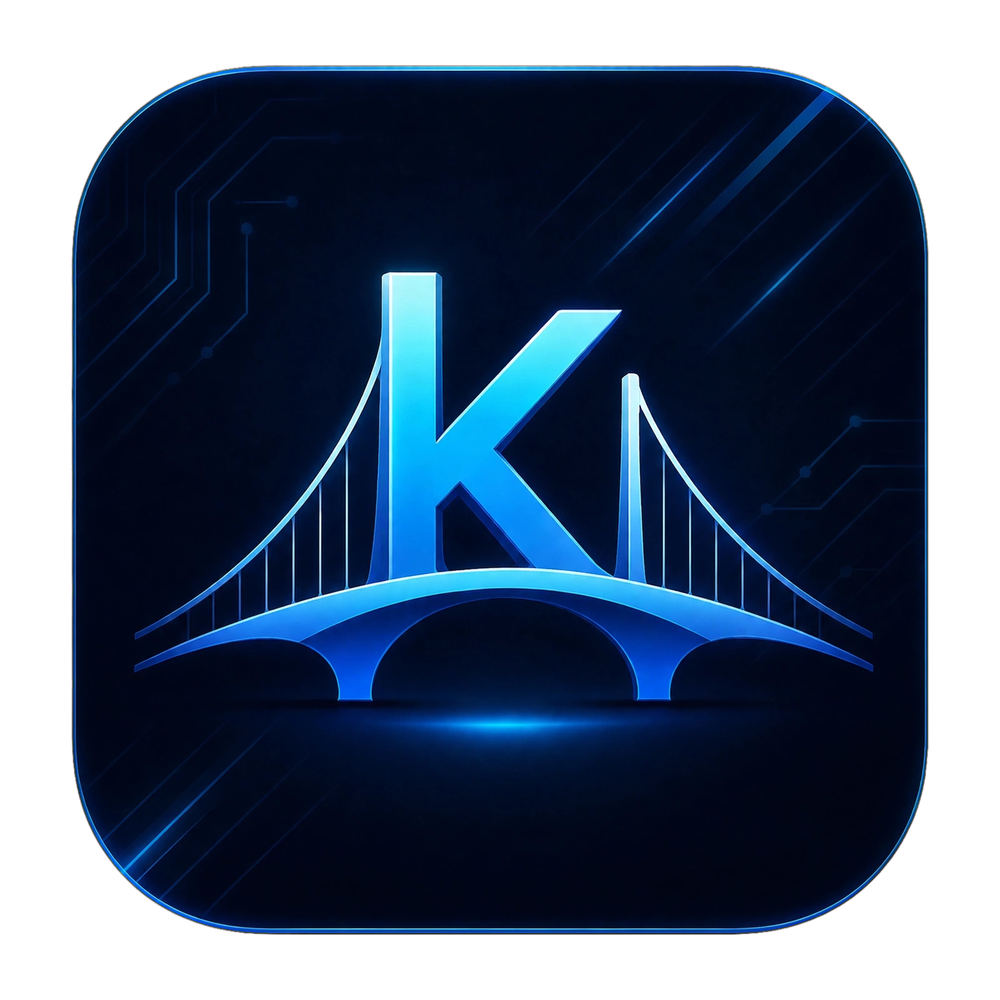

<p align="center">
  
</p>

<h1 align="center">Köpri — Landing Website</h1>

<p align="center">
  <em>A beautiful, fully static promotional site for <a href="https://github.com/Shapak-Apps/K-pri-App-for-phone">Köpri</a> — the offline-first translator for Android.</em>
</p>

<p align="center">
  <a href="https://www.rustore.ru/catalog/app/com.kopri.translator">
    
  </a>
  
  
  
  
</p>

---

## 🌉 About

**Köpri** (Turkmen for *"bridge"*) is an **offline-first translator** for Android: 50+ languages, a huge 4700+ phrasebook, XP/streaks system, and a clean UI with three themes.

This repository contains the **official promotional website** for the app — a single-page landing + a separate organization screen, built with **vanilla HTML/CSS/JS** (no frameworks, no build step).

The design language of the website is **identical to the app**: same cards, same blue accent `#2563EB`, same radii, same glow effects in dark mode, same bottom-nav tabs.

## ✨ Features

| Category | What's inside |
|---|---|
| 🌗 **Themes** | `light` / `dark` / `system` — site follows the app's theming logic, persisted in `localStorage`. |
| 🌍 **Languages** | English · Русский · Türkmençe — instant switch in the header, content + nav + labels. |
| 📱 **Phone mockup** | Interactive: 6 clickable bottom-nav tabs (Sazlamalar / About / Profil / Kartlar / Kamera / Terjime) swap real screenshots live. |
| ⚙️ **Settings demo** | Pixel-perfect replica of the app's settings screen with live toggles and a delay slider. |
| 📸 **Gallery** | Horizontal swipe carousel of all app screenshots. |
| 🏆 **Progress section** | XP, streaks, daily goal — matching the in-app profile screen. |
| 🧡 **Organization screen** | Dedicated `organization.html` page (separate route, not scroll) with gratitude text, 5 team members rendered with real GitHub avatars, and links to the org website & GitHub. |
| 📥 **RuStore badges** | Official RuStore vector icon, in header / hero / CTA / footer — all pointing to the store page. |
| 🔓 **Open source link** | GitHub source link everywhere (header, hero, CTA, footer, OSS section). |
| 📊 **Animated counters** | 4731 phrases, 50+ languages, 100 XP levels, 10–60× speed — animated on scroll. |
| 🎭 **Reveal on scroll** | `IntersectionObserver`-based fade-in for all sections. |
| ♿ **Accessibility** | Semantic HTML, ARIA labels, reduced-motion friendly. |
| 📐 **Fully responsive** | Desktop · tablet · phone (iPhone SE to 4K). |

## 🗂 Project structure

```
.
├── index.html                 # main landing page
├── organization.html          # separate screen for Şapak Apps org
├── style.css                  # site styles (light + dark themes)
├── script.js                  # i18n, theme switch, reveal, counters, phone tabs
├── assets/
│   ├── app_icon.png           # Köpri app icon
│   ├── sapak.png              # Şapak Apps organization logo
│   ├── rustore.svg            # official RuStore vector icon
│   ├── about_light.png        # about screen — light theme
│   ├── about_dark.png         # about screen — dark theme
│   └── screenshots/
│       ├── 1.jpg              # Sazlamalar (Settings)
│       ├── 2.jpg              # Programma barada (About)
│       ├── 3.jpg              # Profil
│       ├── 4.jpg              # Kartlar (Cards)
│       ├── 5.jpg              # Kamera
│       └── 6.jpg              # Terjime (Translate) — default screen
└── README.md
├── LICENSE
```

## 🚀 Getting started

No build step, no dependencies — just open it:

```bash
# clone
git clone https://github.com/Shapak-Apps/K-pri-App-for-phone-site.git
cd K-pri-App-for-phone-site

# serve (pick any one)
python3 -m http.server 8000
npx serve .
open index.html
```

Then visit `http://localhost:8000`.

## 🛠 Tech stack

| Layer | Tech |
|---|---|
| Markup | Semantic HTML5 |
| Styling | Pure CSS3 (custom properties, `color-mix()`, `backdrop-filter`, clamp()) |
| Logic | Vanilla JS (ES6+), no frameworks |
| Fonts | Google Fonts — [Manrope](https://fonts.google.com/specimen/Manrope) (site) · system stack (org page) |
| Icons | Inline SVG + [Wikimedia RuStore logo](https://commons.wikimedia.org/wiki/File:RuStore_logo.svg) |
| Hosting | Static — works on GitHub Pages, Netlify, Vercel, any static host |

## 🎨 Design tokens

```css
/* Light */
--bg: #F4F6FB;   --card: #FFFFFF;   --text: #0C1B33;   --primary: #2563EB;

/* Dark */
--bg: #080D18;   --card: #0E1626;   --text: #E8EEF9;   --primary: #3B82F6;

/* Şapak Apps (organization page only) */
--bg: #FBFAF8;   --brand: #FF851B;  --accent: #B25A0C;
```

## 🧩 Sections of `index.html`

1. **Header** — sticky, blurred backdrop: logo, nav, lang + theme segmented controls, RuStore badge, GitHub pill.
2. **Hero** — title, description, RuStore + GitHub CTAs, 4 animated stats, interactive phone mockup with floating chips.
3. **Marquee** — infinite scrolling phrasebook categories.
4. **Features** — 8 feature cards (translation, offline-first, camera OCR, phrasebook, flashcards, history, XP, native speed).
5. **Interface** — live replica of the app's settings screen (toggles + delay slider).
6. **Themes** — clickable theme picker + full theme preview that switches with the site.
7. **Gallery** — horizontal carousel of 6 real screenshots with scroll-snap.
8. **Progress** — level, streak, daily goal — matching the in-app profile.
9. **Languages** — 3 language cards (EN/RU/TM).
10. **Open source** — repo info, author, tech chips, GitHub button.
11. **Organization** — teaser card with single button opening `organization.html`.
12. **CTA** — final blue gradient call-to-action with RuStore + GitHub.
13. **Footer** — brand, product links, source code links.

## 🧡 `organization.html` (separate screen)

A standalone page — **independent from the main site**, styled in the **Şapak Apps brand colors** (warm paper `#FBFAF8`, orange `#FF851B`), not Köpri's blue. Contains:

- Thank-you message in the active language
- 4 principles (open code, offline-first, free & no ads, in Turkmen)
- 5 team members with **real GitHub avatars** rendered exactly like the [official org site](https://shapak-apps.github.io/)
- All org projects as chips
- 2 action buttons: **Organization website** → `shapak-apps.github.io` · **GitHub organization** → `github.com/Shapak-Apps`

Theme (light/dark/system) and language (EN/RU/TM) are shared with the main site via `localStorage`.

## 🌐 Links

| What | Where |
|---|---|
| 📱 Download on RuStore | https://www.rustore.ru/catalog/app/com.kopri.translator |
| 🐙 App source code | https://github.com/Shapak-Apps/K-pri-App-for-phone |
| 🧡 Şapak Apps website | https://shapak-apps.github.io/ |
| 🏢 Şapak Apps on GitHub | https://github.com/Shapak-Apps/ |

## 👤 Author

**Aýnazar Sylyýew** — [GitHub](https://github.com/aynazar-sylyyew-dev)

Made at [**Şapak Apps**](https://github.com/Shapak-Apps/) — an open-source community from Turkmenistan building free apps in the Turkmen language.

## 🙏 Acknowledgements

Huge thanks to the Şapak Apps community — Seydi Charyyev, Bahram Myradow, Merdan Jumamyradow, Ahmed Batyrov — for code reviews, discussions and the chance to ship real software in Turkmen.

*Flag icons from [lipis/flag-icons](https://github.com/lipis/flag-icons) (MIT). RuStore logo from Wikimedia Commons.*

## 📜 License

The website source code is released under the [MIT License](LICENSE).

The Köpri app and its icon are property of Şapak Apps. The RuStore logo is a trademark of VK Group.